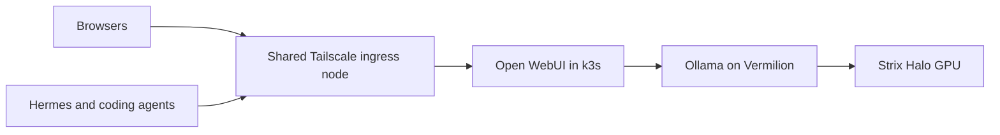

# Kanto

Kanto is a shared inference and infrastructure cluster. Its first host,
Vermilion, is an AMD Ryzen AI Halo with a Ryzen AI Max+ 395, 128 GB of RAM,
and a 2 TB Micron 4600 NVMe. The disk identifier is verified; the facter report
and GPU validation are still pending.

The repository follows Hoenn's flake-parts and import-tree module layout.
Comin reconciles NixOS from `master`. Flux reconciles Kubernetes applications
from `k8s/flux-system/`. SOPS, Renovate, and the development commands follow
Hoenn and Johto.

## Architecture

Vermilion runs a single-node k3s server and host-level Ollama. Open WebUI runs
in Kubernetes and provides browser chat, separate application accounts, and
authenticated Chat Completions API access. Its standalone Tailscale operator Ingress provides
private HTTPS at `openwebui.narwhal-snapper.ts.net`.

ComfyUI runs on Vermilion with ROCm. A Kubernetes proxy connects it to a
separate standalone ingress at `comfyui.narwhal-snapper.ts.net`, shared
with Morgan for a common workspace and job queue.



Share the WebUI ingress node with Morgan through Tailscale node sharing.
Share Vermilion's host node separately for SSH. Both nodes join your existing
tailnet. Morgan remains connected to her own tailnet.

The WebUI Ingress has no ProxyGroup annotation. A ProxyGroup would create a
Tailscale Service address, which cannot currently be shared across tailnets.

Ollama uses Vulkan initially. Its backend port is allowed only from the local
pod bridge. Open WebUI discovers Vermilion's address through `status.hostIP`.
The host's Tailscale client uses `--netfilter-mode=off`, so the NixOS firewall
retains control of host ports. Only SSH and the Kubernetes API are permitted
on the host's Tailscale interface. The operator's ingress node handles HTTPS
independently.

The initial model policy permits one resident model, two parallel requests,
an eight-request queue, and 64K context. Kubelet reserves 96 GiB for the host
and inference and 1 GiB for Kubernetes daemons. These are conservative starting
settings for the planned hardware. They do not enforce a GPU memory partition.
Benchmark concurrent agent sessions before increasing the limits.

## Repository layout

| Path                         | Contents                                                         |
| ---------------------------- | ---------------------------------------------------------------- |
| `nix/hosts/nixos/vermilion/` | Host composition, boot, proposed disk layout, and backups        |
| `nix/modules/`               | Headless defaults, users, Ollama, k3s, Tailscale, and deployment |
| `k8s/`                       | Flux graph, operator, and Open WebUI                             |
| `keys/`                      | Public administrator SSH keys, host keys, and Flux age recipient |
| `secrets/`                   | SOPS-encrypted host credentials and Flux age identity            |
| `k8s/secrets/`               | SOPS-encrypted Kubernetes Secrets                                |
| `docs/`                      | Bootstrap, operations, and inference client setup                |

## Work locally

```sh
nix develop
nix fmt
nix flake check
nix build .#nixosConfigurations.vermilion.config.system.build.toplevel
just check-k8s
```

Use `just flux-status` and `just reconcile <name>` for this cluster. Every
Kubernetes recipe targets the `kanto` context explicitly. Use `blzrd switch
vermilion` only when explicitly deploying a reviewed, provisioned host.

## Complete bootstrap

Follow [Set up the Kanto cluster](docs/kubernetes.md). The remaining inputs are
the physical hardware report and Flux Git deploy key. Morgan's account remains
locked until her SSH public key is added.
No model weights are downloaded by the initial configuration.
